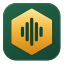
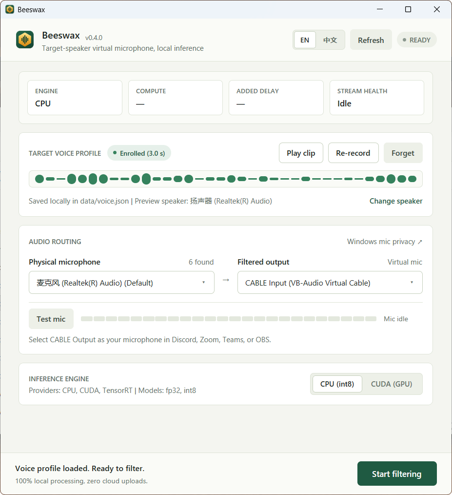
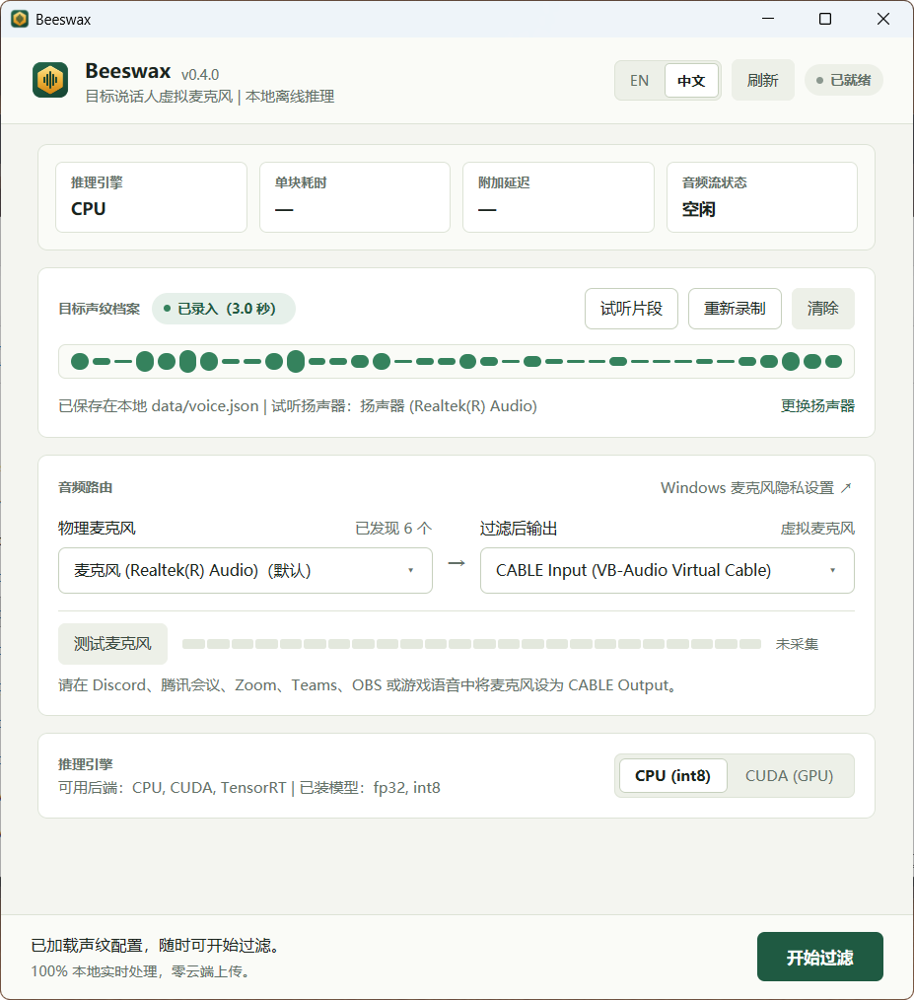

# Beeswax

  

  <strong>Local target-speaker virtual microphone for Windows</strong> 
  Keep only <em>your</em> voice on calls and recordings — 100% offline, with no cloud uploads.

  
  

---

## What It Does

Beeswax listens to your physical microphone, isolates **your enrolled voice** in real time, and sends the clean audio to a virtual microphone (such as **VB-CABLE**) or directly to your headphones.

- **Isolates your voice**: Suppresses background chatter, roommates, TV audio, and room noise.
- **100% private & offline**: Runs locally on your PC. Your voice profile and microphone audio never leave your machine.
- **Ready out of the box**: Release downloads include ONNX Runtime and the voice models — just unzip and run `beeswax.exe`.
- **Bilingual UI**: Built-in **English** and **Simplified Chinese (`中文`)** interface with one-click switching.

---

## Quick Start

1. **Install VB-CABLE (optional, for call apps)**  
   Download and install [VB-CABLE](https://vb-audio.com/Cable/) if you want to use Beeswax as a microphone inside Discord, Zoom, Teams, Tencent Meeting, OBS, or games. *(Skip this if you only want to listen through headphones.)*

2. **Download & Launch**  
   Download `beeswax-windows-x64.zip` from [Releases](https://github.com/ChickenPige0n/Beeswax/releases/latest), extract the folder anywhere, and open **`beeswax.exe`**.

3. **Record Your Voice (6 seconds)**  
   Under **Target Voice Profile**, click **Record voice** and speak naturally by yourself for 6 seconds. Beeswax automatically keeps the clearest 3-second clip. Click **Play clip** to preview it.

4. **Choose Audio Devices**  
   Under **Audio Routing**, pick your **Physical microphone** on the left and **`CABLE Input (VB-Audio Virtual Cable)`** on the right (or choose headphones to monitor directly). Use **Test mic** to verify your input level.

5. **Start Filtering**  
   Click **Start filtering**, then set your microphone in Discord, Zoom, Teams, or OBS to **`CABLE Output (VB-Audio Virtual Cable)`**.

---

## Tips & Troubleshooting

- **Microphone meter is not moving**: Click **Test mic**. If Windows denies access (`0x80070005`), click **Windows mic privacy ↗** in the Audio Routing card and make sure both *Microphone access* and *Let desktop apps access your microphone* are enabled.
- **Echo or feedback**: Only select headphones (never open speakers) when monitoring directly, and keep Windows *"Listen to this device"* turned off.
- **Best sound quality**: Speak at your normal call distance when recording your profile, and disable built-in Windows microphone "Audio Enhancements" if your voice sounds over-processed.

---

## Building from Source & Technical Details

Architecture, DSP/ONNX pipeline details, optional NVIDIA CUDA setup, CLI flags, and build instructions are documented in **[AGENTS.md](AGENTS.md)**.

---

## License & Credits

Beeswax is released under the [MIT License](LICENSE).

Built with [gpui-fast](https://github.com/longbridge/gpui-fast) (Apache-2.0), [ort](https://github.com/pykeio/ort) & [ONNX Runtime](https://github.com/microsoft/onnxruntime) (MIT), and the [VoxLock](https://huggingface.co/arbazsiddiqui/voxlock) target-speaker separation models (Apache-2.0). [VB-CABLE](https://vb-audio.com/Cable/) is a separate product by VB-Audio.
